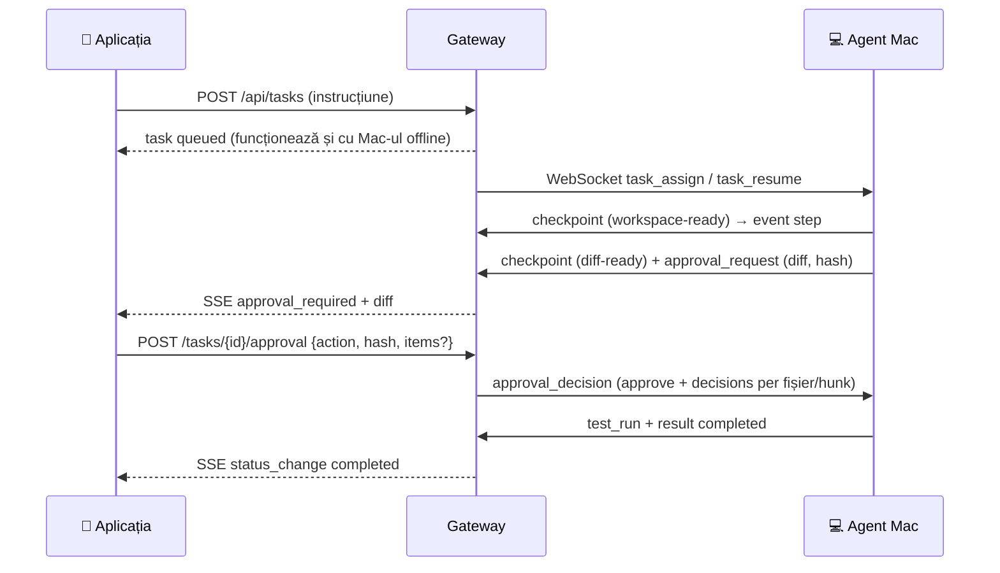

# DevAgent

Platformă de execuție pentru sarcini de cod, controlată de pe telefon:

> scrii o instrucțiune în aplicația mobilă → MacBook-ul o execută într-un
> **git worktree izolat** → vezi diff-ul în timp real → **aprobi sau respingi** →
> abia apoi se aplică, se rulează testele și se comite pe un branch.

Include trei componente care comunică între ele:

| Componentă | Folder | Ce face |
|---|---|---|
| **Gateway** | [`gateway/`](gateway) | coadă de sarcini (funcționează cu laptopul offline), stări, evenimente live (SSE + Redis pub/sub), aprobări cu hash, reluare din checkpoint, canal WebSocket pentru agent |
| **Agent macOS** | [`agent/`](agent) | se conectează *outbound* (WebSocket, fără porturi deschise pe Mac), creează worktree izolat, generează patch-ul (LLM sau plan manual), așteaptă aprobarea, aplică doar ce s-a aprobat, rulează testele, comite / push / PR |
| **Aplicația mobilă** | [`src/`](src), [`capacitor.config.ts`](capacitor.config.ts) | PWA (React + Vite + Tailwind) cu 4 ecrane — Sarcină nouă, Execuție live, Revizuire modificări, Istoric — instalabilă pe telefon și împachetată nativ pentru **iOS** prin Capacitor |

Documentația completă (arhitectură, plan de implementare pe faze, referință API,
protocol WebSocket, troubleshooting, backup) este în [`docs/DEPLOY.md`](docs/DEPLOY.md).

---

## Cerințe acoperite

* **coadă de sarcini** care funcționează și când MacBook-ul este offline (`queued` rămâne în coadă, dispatch automat la reconectare);
* **identificator unic** per sarcină (`task-<10 hex>`, cu suport de `idempotencyKey`);
* **stări explicite**: `queued`, `running`, `awaiting_approval` (alias `waiting_approval`), `completed`, `failed`, `cancelled`;
* **evenimente și progres în timp real**: SSE per sarcină și global, replay după `Last-Event-ID`;
* **aprobarea modificărilor înainte de aplicare**: propunere cu `hash` (optimistic locking, `409` la propunere expirată), granularitate per sarcină / per fișier / per hunk, mai multe gate-uri în ordine `plan → diff → apply → commit`;
* **reconectarea agentului și reluarea sigură**: heartbeat + watchdog, sarcina întreruptă revine în coadă și se reia din ultimul checkpoint (`resume`, `await_approval`, `apply_approved`).* **flotă multi-agent**: oricâte mașini (MacBook, al doilea laptop, un Linux box) se pot conecta simultan — fiecare cu `DEVAGENT_AGENT_ID` propriu; sarcina merge la primul worker liber care satisface cerințele, sau o fixezi pe o mașină (`agentId`) / pe capabilități (`requiredCapabilities`, ex. `["pull-request"]`).
---

## Pornire rapidă

### 1. Gateway (pe server, în spatele unui Cloudflare Tunnel)

```sh
cd gateway
cp env.example /etc/deepseek-devagent.env      # completați DEVAGENT_TOKEN / DEVAGENT_AGENT_TOKEN
chmod 600 /etc/deepseek-devagent.env
python3 -m venv .venv && .venv/bin/pip install -r requirements.txt
.venv/bin/python -m pytest tests -q            # 12 teste
.venv/bin/uvicorn app.server:create_app --factory --host 127.0.0.1 --port 8082
```

Expunere publică (regula de path trebuie să precedă regula de hostname):

```yaml
ingress:
  - hostname: deepseek-api.cs-hub.xyz
    path: /mobile*                 # PWA + API + WebSocket agent
    service: http://127.0.0.1:8082
  - hostname: deepseek-api.cs-hub.xyz
    service: http://127.0.0.1:8081  # proxy-ul DeepSeek existent
  - service: http_status:404
```

### 2. Aplicația (PWA + iOS)

```sh
npm install --legacy-peer-deps
npm run build                      # bundle-ul servit de gateway la /mobile

npx cap add ios                    # o singură dată (necesită Xcode + CocoaPods)
npm run cap:sync                   # build + copiere în proiectul nativ
npm run cap:open                   # deschide Xcode → rulare pe iPhone / TestFlight
```

În aplicație: **Settings → Gateway connection** → URL gateway
(`https://deepseek-api.cs-hub.xyz/mobile`) + tokenul `DEVAGENT_TOKEN` → *Save & test*.
În shell-ul nativ iOS originea este `capacitor://localhost`, de aceea URL-ul și
tokenul se configurează la runtime și se salvează pe dispozitiv.

Link de configurare unică (util de pe telefon):
`https://deepseek-api.cs-hub.xyz/mobile/?token=<DEVAGENT_TOKEN>`.

### 3. Agentul de pe MacBook

```sh
python3 -m pip install --user websockets
mkdir -p ~/.devagent && cp agent/agent.env.example ~/.devagent/agent.env
chmod 600 ~/.devagent/agent.env     # token agent, workspaces permise, endpoint LLM
python3 agent/devagent_agent.py --check
python3 agent/devagent_agent.py --verbose        # sau launchd: agent/com.devagent.agent.plist
```

Pe fiecare mașină suplimentară repeți pașii cu alt `DEVAGENT_AGENT_ID` (implicit =
numele hostului) și **același** `DEVAGENT_AGENT_TOKEN`. Toate apar în aplicație ca o
flotă, iar în ecranul de sarcină nouă alegi „Run on: Any idle agent" sau o mașină anume.

> Dacă gateway-ul e publicat prin Cloudflare, agentul are nevoie de headere de browser
> (`DEVAGENT_BROWSER_HEADERS=true`, implicit) — altfel Cloudflare răspunde `403` la
> handshake și agentul apare offline deși procesul rulează.

### 4. Test end-to-end

```sh
DEVAGENT_AGENT_PYTHON=python3 bash scripts/smoke.sh
# creează un repo temporar, pornește agentul, trimite o sarcină, aprobă propunerea,
# verifică commit-ul pe branch și reluarea după reconectare
```

---

## Fluxul unei sarcini



Dacă laptopul dispare între timp: gateway-ul marchează sarcina `interruptedAt`,
o repune în coadă, păstrează propunerea validă, iar la reconectare trimite
`task_resume` cu acțiunea potrivită (`resume` / `await_approval` / `apply_approved`).

---

## Referință scurtă API

Toate rutele cer token (`Authorization: Bearer <DEVAGENT_TOKEN>` sau `?token=` — obligatoriu
pentru `EventSource`). `/healthz` este public.

`GET /api/agent/status` · `GET|POST /api/tasks` · `GET /api/tasks/{id}` ·
`POST /api/tasks/{id}/approval` · `POST /api/tasks/{id}/cancel` · `POST /api/tasks/{id}/retry` ·
`GET /api/tasks/{id}/events` (SSE) · `GET /api/events` (SSE global) ·
`GET /api/agents` (flotă) · `DELETE /api/agents/{id}` (uită un agent deconectat) ·
`GET /api/diagnostics` · `GET /api/workspaces` · `WS /agent/ws`

Detalii complete: [`docs/DEPLOY.md`](docs/DEPLOY.md) §9 (API) și §10 (protocol WebSocket).

---

## Securitate

* token partajat pentru interfață + token separat pentru agenți, comparate cu `hmac.compare_digest`;
* staticul PWA este public, dar `/api/**` și `/agent/**` cer token;
* gateway-ul ascultă doar pe `127.0.0.1`, expunerea trece prin Cloudflare Tunnel;
* nimic nu se aplică înainte de aprobare, iar editarea se face doar în worktree izolat;
* comenzile shell rulează doar cu aprobare explicită;
* secretele stau în `/etc/deepseek-devagent.env` (600) și `~/.devagent/agent.env` (600) — nu în git.

## Stare

* gateway: 12 teste automate (`pytest`) + test end-to-end cu agent real (`scripts/smoke.sh`);
* PWA: build verificat, servit de gateway la `/mobile`, instalabilă pe telefon;
* iOS: proiectul nativ se generează cu Capacitor pe un Mac cu Xcode (`npx cap add ios`).
