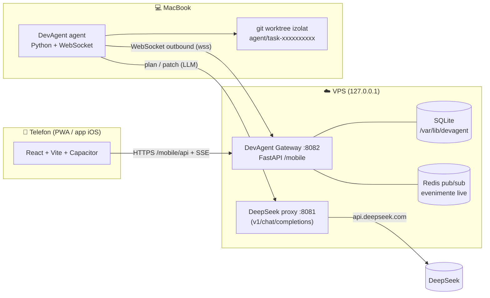

# DevAgent - gateway, agent macOS și aplicație mobilă (PWA + iOS)

> **Repo ↔ deployment.** Acest document descrie deployment-ul de pe VPS, unde codul
> rulează din `/opt/deepseek-proxy/devagent/`. În repo, codul este organizat astfel:
>
> | Repo | Server (deployment) |
> |---|---|
> | `gateway/app/`, `gateway/tests/`, `gateway/requirements.txt`, `gateway/env.example` | `/opt/deepseek-proxy/devagent/gateway/...` |
> | `agent/` | `/opt/deepseek-proxy/devagent/agent/` |
> | `systemd/devagent-gateway.service` | `/etc/systemd/system/devagent-gateway.service` |
> | `scripts/smoke.sh` | `/opt/deepseek-proxy/devagent/tests/smoke.sh` |
> | `src/`, `vite.config.ts`, `capacitor.config.ts` (rădăcina repo-ului) | `/opt/deepseek-proxy/mobile/` |
>
> Sincronizare repo → server: `scripts/sync-to-server.sh [--restart] [--dry-run]`.
> Restul acestui document folosește căile de pe server.

Platformă de execuție pentru sarcini de cod: scrii o instrucțiune de pe telefon,
MacBook-ul o execută într-un worktree izolat, **nimic nu se aplică înainte de
aprobarea ta**, iar dacă laptopul se deconectează sarcina se reia din ultimul
checkpoint în loc să o ia de la zero.

Public: **https://deepseek-api.cs-hub.xyz/mobile** (PWA) ·
`wss://deepseek-api.cs-hub.xyz/mobile/agent/ws` (agent) ·
`https://deepseek-api.cs-hub.xyz/mobile/api/**` (API).

---

## 1. Ce este livrat astăzi

| Componentă | Locație | Stare |
|---|---|---|
| Gateway (API + coadă + stări + aprobări + WebSocket agenți) | `/opt/deepseek-proxy/devagent/gateway` | ✅ implementat, 12 teste trec |
| Protocol agent (WS + heartbeat + checkpoint + aprobare) | `app/api_agent.py`, secțiunea 7 | ✅ implementat |
| Agent macOS de referință | `/opt/deepseek-proxy/devagent/agent/devagent_agent.py` | ✅ implementat |
| PWA în `DevAgent-mobile` | `/opt/deepseek-proxy/mobile` | ✅ adaptat pentru `/mobile`, token + URL configurabil, `npm run build` OK |
| Aplicație iOS nativă (Capacitor → Xcode) | `mobile/capacitor.config.ts`, `mobile/ios` | 🟡 Capacitor configurat în repo; proiectul Xcode se generează pe MacBook (pasul 6) |
| Ops: Redis, systemd, regulă tunnel, backup | `devagent/systemd`, `/etc/deepseek-devagent.env` | ✅ aplicate pe VPS (Redis activ, `devagent-gateway.service`, regulă `/mobile*` în ambele tuneluri, `backup.sh` extins) |

Cerințe acoperite de gateway:

* **coadă de sarcini** care funcționează și când MacBook-ul e offline (`queued` rămâne în coadă, dispatch-ul se face automat la reconectare);
* **identificator unic** per sarcină: `task-<10 hex>`;
* **stări**: `queued`, `running`, `awaiting_approval` (alias acceptat `waiting_approval`), `completed`, `failed`, `cancelled`;
* **evenimente și progres în timp real**: SSE (`/mobile/api/events`, `/mobile/api/tasks/{id}/events`) alimentat din Redis pub/sub, cu replay după `Last-Event-ID`;
* **aprobare înainte de aplicare**: propunere cu `hash` (optimistic locking), granularitate per sarcină / per fișier / per hunk, mai multe gate-uri în ordine (`plan → diff → apply → commit`);
* **reconectare și reluare sigură**: heartbeat + watchdog, sarcina întreruptă revine în coadă și se reia din ultimul checkpoint raportat de agent.

### Verificat live pe acest VPS

```
GET  http://127.0.0.1:8082/healthz      -> {"status":"ok","version":"1.0.0","agentSockets":0,"eventBus":"redis"}
GET  https://<host>/mobile/              -> 200, se încarcă shell-ul PWA (Chromium real)
GET  https://<host>/mobile/api/health    -> 401 (ajunge la gateway, cere token)
POST /mobile/api/tasks + aprobare        -> task queued -> running -> awaiting_approval -> completed
POST /mobile/api/tasks/{id}/approval     -> propunere respinsă/greșită => 409; aprobată => aplicată pe branch
reconectare agent în timpul aprobării    -> task_resume action=apply_approved -> completed
pytest (gateway)                         -> 12 passed
"$DEVAGENT_AGENT_PYTHON" devagent/tests/smoke.sh -> ✅ (agent real + coadă + aprobare + commit + reluare)
```

Atenție la testarea din linia de comandă: Cloudflare are protecție anti-bot pe zonă, deci
`curl` primește `403 Your request was blocked` pe rute care nu sunt exceptate
(`/healthz` și `/v1/*` sunt exceptate). Din browser / din WebView-ul iOS totul trece normal
- testați cu un browser real, nu cu `curl`.

---

## 2. Arhitectură



Fluxul unei sarcini:

```
queued ──dispatch──▶ running ──agent: approval_request──▶ awaiting_approval
   ▲                    │                                      │
   │                    │◀───────── approve (hash valid) ────────┤
   │                    │                                      │
   └─ watchdog/reluare ─┘                              reject ─▶ failed
                        └──── agent: result ────▶ completed
```

---

## 3. Plan de implementare

Fiecare fază este independentă și verificabilă. Statusul reflectă ce este deja
în repo.

### Faza 0 - fundație (✅ gata)
1. Structură monorepo în workspace-ul existent: `devagent/gateway`, `devagent/agent`, `devagent/systemd`, `mobile/` (repo-ul `DevAgent-mobile`).
2. Config 12-factor (`app/config.py`, `gateway/env.example`, `agent/agent.env.example`).
3. Persistență SQLite (`app/db.py`): `tasks`, `task_events` (seq global = `Last-Event-ID`), `approvals`, `checkpoints`, `agents`, `kv`.

### Faza 1 - coadă, stări și identitate (✅ gata)
4. `TaskService.create_task` generează `task-<10 hex>`, acceptă `idempotencyKey`, alege gate-urile implicite pe mod (`supervised`/`dry-run` → `diff`, `autonomous` → niciunul).
5. Sarcina rămâne `queued` cu agentul offline; la reconectare `resume_tasks_for_agent` + `dispatch_pending` o preiau imediat.

### Faza 2 - evenimente live (✅ gata)
6. Fiecare tranziție scrie un eveniment în DB **și** îl publică pe `devagent:events` (Redis), cu fallback in-process dacă Redis lipsește.
7. SSE pentru PWA: `init` + `message` per sarcină, `connected` + `agent_status` global, keep-alive la 15s.

### Faza 3 - aprobări (✅ gata)
8. Propunerea este creată de agent (`approval_request`) cu `diff`, listă de fișiere și itemi per-fișier/per-hunk derivați din diff.
9. Operatorul decide cu `{action, hash, comment?, items?}`; hash greșit → `409`, decizie dublă → `409`.
10. Gate-uri multiple în ordine (`plan → diff → apply → commit`); dacă toate itemii sunt respinși, propunerea devine respingere.
11. Expirare opțională a propunerii (`DEVAGENT_APPROVAL_TIMEOUT_SECONDS`).

### Faza 4 - reconectare și reluare (✅ gata)
12. Heartbeat agent → watchdog (`app/scheduler.py`): lipsă heartbeat `N` secunde ⇒ agent `offline`, sarcina `running` revine în `queued` cu `interrupted_at`, propunerile rămase `pending` rămân valide.
13. La reconectare, gateway-ul trimite `task_resume` cu checkpoint + acțiunea corectă: `resume`, `await_approval` sau `apply_approved`.
14. Agentul persistă local starea (`~/.devagent/state/<task>.json`) și reutilizează worktree-ul izolat.

### Faza 5 - PWA servit la `/mobile` (🟡 pasul 5)
15. `base: '/mobile/'`, manifest `start_url/scope: '/mobile/'`, `workbox.navigateFallback`, denylist `/mobile/api`.
16. Client API cu URL + token configurabile (necesar și pentru aplicația iOS).
17. Build → `dist/` servit de gateway (`DEVAGENT_STATIC_DIR`), SPA fallback pentru deep links.

### Faza 6 - aplicație iOS nativă (🟡 pasul 6)
18. Capacitor 7 (`@capacitor/core|cli|ios`) peste același build React.
19. Ecran de setări: URL gateway + token (WKWebView nu are same-origin cu API-ul).
20. `npx cap sync ios` → proiect Xcode → rulare pe device / TestFlight.

### Faza 7 - operațiuni (🟡 pașii 2-4, 8)
21. Redis local (`127.0.0.1:6379`), serviciu systemd `devagent-gateway.service`, regulă de path în tunnelul Cloudflare existent.
22. Smoke test end-to-end + integrare în `backup.sh`.
23. Enrolarea MacBook-ului (launchd) și testul de reconectare „la minut real”.

---

## 4. Instrucțiuni: serverul (gateway)

Presupune Ubuntu (ca VPS-ul actual), acces root, proiectul în `/opt/deepseek-proxy`.

### 4.1 Redis (pub/sub pentru evenimente live)

```sh
apt-get update && apt-get install -y redis-server
# ascultă doar local; verificare
ss -ltnp | grep 6379          # trebuie 127.0.0.1:6379
redis-cli ping                # PONG
systemctl enable --now redis-server
```

Fără Redis gateway-ul funcționează (fan-out in-process), dar un al doilea worker
uvicorn sau un restart nu ar mai distribui evenimentele către toate conexiunile.

### 4.2 Cont de serviciu, permisiuni, secrete

```sh
# user fără privilegii + director de date
useradd --system --home-dir /var/lib/devagent --shell /usr/sbin/nologin devagent || true
install -d -o devagent -g devagent -m 0750 /var/lib/devagent

# secrete (niciun secret în git!)
install -m 600 -o root -g root devagent/gateway/env.example /etc/deepseek-devagent.env
python3 - <<'PY'
import secrets
print("DEVAGENT_TOKEN      =", secrets.token_hex(32))
print("DEVAGENT_AGENT_TOKEN=", secrets.token_hex(32))
PY
nano /etc/deepseek-devagent.env      # completați cele două tokenuri

# gateway-ul citește PWA-ul compilat
chmod o+rX /opt/deepseek-proxy /opt/deepseek-proxy/mobile
```

### 4.3 Mediul Python

```sh
cd /opt/deepseek-proxy/devagent/gateway
python3 -m venv .venv
.venv/bin/pip install -r requirements.txt
.venv/bin/python -m pytest tests -q          # 12 teste
```

### 4.4 Serviciu systemd

```sh
install -m 644 devagent/systemd/devagent-gateway.service /etc/systemd/system/
systemctl daemon-reload
systemctl enable --now devagent-gateway
systemctl status devagent-gateway --no-pager
journalctl -u devagent-gateway -f
curl -s http://127.0.0.1:8082/healthz
# {"status":"ok","version":"1.0.0","agentSockets":0,"eventBus":"redis"}
```

### 4.5 Expunere publică prin tunnelul existent

⚠️ Pe acest VPS hostname-ul `deepseek-api.cs-hub.xyz` este declarat în **două** tuneluri
Cloudflare, ambele active:

| Unit systemd | Config | Rol |
|---|---|---|
| `cloudflared` (`postgres-tunnel`) | `/etc/cloudflared/config.yml` | regula veche `deepseek-api.cs-hub.xyz → 8081` |
| `vacanta-tunnel` (`vacanta-arcadia`) | `/root/.cloudflared/config.yml` | restul hostname-urilor |

Regula de path trebuie să existe în configul tunelului care servește hostname-ul
(`/mobile/api/health` a răspuns 404 de la proxy-ul de pe 8081 până am adăugat regula în
`/etc/cloudflared/config.yml`). Din acest motiv regula este prezentă acum în **ambele**
configuri, iar schimbarea se validează local înainte de restart:

```yaml
ingress:
  - hostname: deepseek-api.cs-hub.xyz
    path: /mobile*            # PWA + API + WebSocket agent
    service: http://127.0.0.1:8082
  - hostname: deepseek-api.cs-hub.xyz
    service: http://127.0.0.1:8081   # proxy-ul DeepSeek existent (neatins)
  - service: http_status:404
```

```sh
cloudflared --config /etc/cloudflared/config.yml tunnel ingress validate
cloudflared --config /etc/cloudflared/config.yml tunnel ingress rule https://deepseek-api.cs-hub.xyz/mobile/  # trebuie sa indice 8082
cp /etc/cloudflared/config.yml "/etc/cloudflared/config.yml.bak-$(date +%F-%H%M%S)"   # inainte de orice editare
systemctl restart vacanta-tunnel cloudflared
# verificare realista (browser, nu curl): https://deepseek-api.cs-hub.xyz/mobile/
```

---

## 5. Instrucțiuni: PWA servit la `/mobile`

Repo-ul `mobile/` face parte din workspace (clone al `CsepregiArtur/DevAgent-mobile`).

### 5.1 Sub-cale `/mobile` (`mobile/vite.config.ts`)

```ts
export default defineConfig(() => ({
  base: '/mobile/',
  plugins: [
    react(), tailwindcss(),
    VitePWA({
      registerType: 'autoUpdate',
      manifest: {
        id: '/mobile/',
        start_url: '/mobile/',
        scope: '/mobile/',
        icons: [
          { src: '/mobile/pwa-192x192.png', sizes: '192x192', type: 'image/png', purpose: 'any' },
          { src: '/mobile/pwa-512x512.png', sizes: '512x512', type: 'image/png', purpose: 'any' },
          { src: '/mobile/pwa-maskable-512x512.png', sizes: '512x512', type: 'image/png', purpose: 'maskable' },
        ],
      },
      workbox: {
        globPatterns: ['**/*.{js,css,html,ico,png,svg,woff,woff2}'],
        navigateFallback: '/mobile/index.html',
        navigateFallbackDenylist: [/^\/mobile\/api/, /^\/mobile\/agent/],
      },
    }),
  ],
}));
```

### 5.2 Client API cu URL + token configurabile (`mobile/src/services/api.ts`)

```ts
const DEFAULT_BASE = import.meta.env.BASE_URL.replace(/\/$/, ''); // '/mobile'
export function getGatewayBase(): string {
  return localStorage.getItem('devagent.baseUrl') || DEFAULT_BASE;
}
export function getToken(): string {
  return localStorage.getItem('devagent.token') || '';
}
function authHeaders(extra: Record<string, string> = {}) {
  const token = getToken();
  return token ? { ...extra, Authorization: `Bearer ${token}` } : extra;
}
// toate fetch-urile: fetch(`${getGatewayBase()}/api/...`, { headers: authHeaders({...}) })
// SSE (EventSource nu poate trimite headere): `${base}/api/events?token=${encodeURIComponent(token)}`
```

### 5.3 Build + servire

```sh
cd /opt/deepseek-proxy/mobile
npm install --legacy-peer-deps     # sau: bun install (există bun.lock)
npm run build                      # produce dist/
systemctl restart devagent-gateway # servește dist/ la /mobile
curl -sI https://deepseek-api.cs-hub.xyz/mobile/ | head -3
```

Pe telefon: deschide `https://deepseek-api.cs-hub.xyz/mobile`, adaugă tokenul în
ecranul **Settings** (se salvează în `localStorage`), apoi „Add to Home Screen”.

Dev local fără build: `npm run dev` pornește serverul Express mock din repo
(`server.ts`) — util pentru UI, dar fără coadă/reluare reale.

---

## 6. Instrucțiuni: aplicația iOS (nativă prin Capacitor)

Se rulează **pe MacBook** (are nevoie de Xcode); rezultatul este un proiect Xcode
în `mobile/ios`, din care faci build pe device sau în TestFlight.

### 6.1 Instalare și inițializare

```sh
cd /opt/deepseek-proxy/mobile        # sau clonează repo-ul pe Mac
npm install --legacy-peer-deps
npm install @capacitor/core@^7 @capacitor/app@^7 @capacitor/preferences@^7
npm install -D @capacitor/cli@^7 @capacitor/ios@^7

npx cap init "DevAgent" xyz.cshub.devagent --web-dir dist
```

`mobile/capacitor.config.ts`:

```ts
import type { CapacitorConfig } from '@capacitor/cli';

const config: CapacitorConfig = {
  appId: 'xyz.cshub.devagent',
  appName: 'DevAgent',
  webDir: 'dist',
  bundledWebRuntime: false,
  server: { androidScheme: 'https' },
  ios: { contentInset: 'always', limitsNavigationsToAppBoundDomains: false },
};

export default config;
```

### 6.2 Build web + proiect Xcode

```sh
npm run build
npx cap add ios          # o singură dată: creează mobile/ios
npx cap sync ios         # copiază dist/ + pluginurile native
npx cap open ios         # deschide Xcode (necesită CocoaPods: brew install cocoapods)
```

În Xcode: alege signing team, bundle id `xyz.cshub.devagent`, rulează pe iPhone.
Pentru distribuție: Product → Archive → Distribute App → TestFlight.

După orice modificare în `src/`: `npm run build && npx cap sync ios`.

### 6.3 De ce e nevoie de URL + token în aplicație

În shell-ul nativ, originea este `capacitor://localhost`, deci `fetch('/api/...')`
nu ajunge la gateway. Din acest motiv clientul are URL configurabil (implicit
`https://deepseek-api.cs-hub.xyz/mobile`) + tokenul introdus în **Settings**
(`@capacitor/preferences` sau `localStorage`). Gateway-ul acceptă deja aceste
origini prin CORS (`capacitor://localhost`, `ionic://localhost`).

### 6.4 Opțional: notificări push

Se adaugă după ce fluxul de bază funcționează: `@capacitor/push-notifications` +
APNs; evenimentele relevante sunt `approval_required` („ai o modificare de
aprobat”) și `status_change` pe `completed`/`failed`.

---

## 7. Instrucțiuni: agentul de pe MacBook

### 7.1 Instalare

```sh
mkdir -p ~/devagent ~/.devagent
cp /opt/deepseek-proxy/devagent/agent/devagent_agent.py ~/devagent/     # sau git clone al proiectului
cp /opt/deepseek-proxy/devagent/agent/agent.env.example ~/.devagent/agent.env
chmod 600 ~/.devagent/agent.env
python3 -m pip install --user websockets

# completați în ~/.devagent/agent.env:
#   DEVAGENT_AGENT_TOKEN   (identic cu DEVAGENT_AGENT_TOKEN de pe server)
#   DEVAGENT_WORKSPACES    (ex. /Users/artur/dev)
#   DEVAGENT_LLM_TOKEN     (PROXY_SECRET_KEY al proxy-ului DeepSeek)

python3 ~/devagent/devagent_agent.py --check       # validează configul, git, gh, workspace-uri
python3 ~/devagent/devagent_agent.py --verbose     # rulare în prim-plan (Ctrl+C pentru oprire)
```

### 7.2 Pornire automată (launchd)

```sh
cp /opt/deepseek-proxy/devagent/agent/com.devagent.agent.plist ~/Library/LaunchAgents/
# ajustați căile din plist dacă nu folosiți /Users/artur
launchctl load -w ~/Library/LaunchAgents/com.devagent.agent.plist
tail -f ~/.devagent/agent.out.log
```

Agentul se conectează **outbound** (WebSocket) - nu deschide niciun port pe Mac.
Laptopul poate intra în sleep, poate pierde Wi-Fi; la revenire se reconectează cu
backoff exponențial (1s → 30s) și reia sarcinile primite cu `task_resume`.

### 7.3 Ce face agentul pentru fiecare sarcină

1. rezolvă workspace-ul (whitelist `DEVAGENT_WORKSPACES`) și creează un **git worktree izolat** pe branch-ul `agent/task-xxxxxxxxxx` (`~/.devagent/worktrees/...`);
2. checkpoint `workspace-ready` → gateway;
3. generează patch-ul: LLM (proxy privat DeepSeek) sau, fără endpoint LLM, un `DEVAGENT_PLAN.md` de revizuit;
4. checkpoint `diff-ready` și `approval_request` către gateway (diff + fișiere + itemi per hunk);
5. așteaptă decizia operatorului (poate fi luată și când MacBook-ul e offline);
6. aplică doar ce s-a aprobat (`git apply`, filtrat per fișier/hunk), rulează testele (comandă aprobată separat), comite pe branch;
7. trimite `result` (`completed`/`failed`) cu sumar, fișiere, ieșirea testelor, branch.

`DEVAGENT_DRY_RUN=true` generează propunerea fără a aplica nimic (mod verificare).

---

## 8. Verificare end-to-end

Test automat (creează un repo git temporar, pornește agentul real, aprobă propunerea,
verifică commit-ul pe branch și reluarea după reconectare):

```sh
# pe server: interpretorul care are pachetul websockets
python3 -m venv /opt/deepseek-proxy/devagent/agent/.venv
/opt/deepseek-proxy/devagent/agent/.venv/bin/pip install websockets
DEVAGENT_AGENT_PYTHON=/opt/deepseek-proxy/devagent/agent/.venv/bin/python \
  bash /opt/deepseek-proxy/devagent/tests/smoke.sh
```

Verificări manuale:

```sh
# 0) token în shell (NU îl muta în git/chat)
set -a; . /etc/deepseek-devagent.env; set +a
B=https://deepseek-api.cs-hub.xyz/mobile

# 1) gateway + bus de evenimente
curl -s $B/api/health?token=$DEVAGENT_TOKEN

# 2) flux live: SSE într-un terminal, acțiuni în altul
curl -sN "$B/api/events?token=$DEVAGENT_TOKEN" &
curl -s -X POST "$B/api/tasks?token=$DEVAGENT_TOKEN" \
  -H 'Content-Type: application/json' \
  -d '{"instruction":"Adaugă rate limiting pe /login","mode":"supervised"}' | jq .

# 3) coada cu agentul offline: sarcina rămâne 'queued'
curl -s "$B/api/tasks?token=$DEVAGENT_TOKEN" | jq '.tasks[] | {id,status}'

# 4) agent online -> 'running' -> 'awaiting_approval' (apare propunerea)
# 5) aprobă (hash-ul din propunere) sau respinge
curl -s -X POST "$B/api/tasks/<task-id>/approval?token=$DEVAGENT_TOKEN" \
  -H 'Content-Type: application/json' \
  -d '{"action":"approve","hash":"<hash>","comment":"ok"}'

# 6) testul de reconectare: închide MacBook-ul (sau Wi-Fi) în timpul execuției,
#    apoi redeschide: în History trebuie să vezi 'interruptedAt' + reluarea din checkpoint.
```

Fără MacBook poți valida tot fluxul cu simulatorul integrat:
`Settings → Agent Worker Simulator` (sau `POST /api/agent/simulate-toggle`).

---

## 9. Referință API (PWA)

Toate rutele cer token: `Authorization: Bearer <DEVAGENT_TOKEN>` sau `?token=`
(necesar pentru `EventSource`, care nu poate trimite headere). `/healthz` este public.

| Metodă | Rută | Descriere |
|---|---|---|
| GET | `/mobile/api/agent/status` | stare agent + `isSimulated` |
| POST | `/mobile/api/agent/heartbeat` | heartbeat REST (compat; oprește simulatorul) |
| POST | `/mobile/api/agent/simulate-toggle` | activează/dezactivează simulatorul |
| GET | `/mobile/api/agents` | toți agenții cunoscuți |
| GET | `/mobile/api/tasks?status=&search=&limit=&offset=` | listare filtrare/paginare |
| POST | `/mobile/api/tasks` | `{instruction, workspace?, mode?, model?, gates?, idempotencyKey?}` → `201` |
| GET | `/mobile/api/tasks/{id}` | sarcina cu `events`, `approval`, `approvals`, `checkpoints` |
| POST | `/mobile/api/tasks/{id}/cancel` | anulare (agentul e notificat) |
| POST | `/mobile/api/tasks/{id}/retry` | re-încoadă, checkpoint-uri vechi șterse |
| POST | `/mobile/api/tasks/{id}/approval` | `{action, hash, comment?, items?}` → `200` / `400` / `409` |
| GET | `/mobile/api/tasks/{id}/checkpoints` | punctele de reluare ale sarcinii |
| GET | `/mobile/api/tasks/{id}/events` | SSE: `init` apoi `message` per eveniment, replay `Last-Event-ID` |
| GET | `/mobile/api/events` | SSE global: `connected`, `agent_status`, `message` |
| GET | `/mobile/api/diagnostics` | diagnostice gateway/agent/coadă/protocol |
| GET | `/mobile/api/workspaces` | workspace-uri disponibile |

Exemplu de itemi pentru revizuire per fișier/hunk în `approval`:

```json
{
  "action": "approve",
  "hash": "sha256:...",
  "items": [
    { "path": "src/routes/auth.ts", "decision": "approve", "hunks": [1, 2] },
    { "path": "src/middleware/rate-limiter.ts", "decision": "reject" }
  ]
}
```

---

## 10. Protocol WebSocket agent

`wss://<host>/mobile/agent/ws?token=<DEVAGENT_AGENT_TOKEN>&agentId=<id>`

**agent → gateway**

| `type` | Câmpuri principale | Răspuns |
|---|---|---|
| `hello` | `hostname, os, version, workspace, capabilities[], batteryLevel?, activeTaskId?` | `welcome` (include `resumedTasks[]`) |
| `heartbeat` | `activeTaskId?, stats` | `heartbeat_ack` |
| `event` / `progress` / `log` | `taskId, eventType, message, details?, stepNumber?, totalSteps?, currentStep?` | `event_ack` |
| `checkpoint` | `taskId, name, payload, idempotencyKey` | `checkpoint_ack` |
| `approval_request` | `taskId, gate, summary, diff, hash, files[]` | `approval_ack` |
| `result` | `taskId, status: completed\|failed, result?, error?` | `result_ack` |
| `ping` | - | `pong` |

**gateway → agent**

| `type` | Semnificație |
|---|---|
| `welcome` | handshake: intervale de heartbeat, timeout aprobare, `resumedTasks` |
| `task_assign` | sarcină nouă: `action: "start"` |
| `task_resume` | continuare: `action` = `resume` (din checkpoint), `await_approval` (propunere în așteptare) sau `apply_approved` (aproape cât laptopul era offline) |
| `approval_decision` | decizia operatorului + `decisions` per fișier/hunk + `nextGate` |
| `cancel` | anulare |
| `error` | eroare de protocol/domaină (ex. gate în afara ordinii) |

Cheile de idempotență (`idempotencyKey`) fac re-livrarea sigură: un checkpoint
repetat nu creează duplicate.

---

## 11. Securitate

* Token partajat (PWA) + token separat pentru agenți; comparație `hmac.compare_digest`.
* Staticul PWA este public (are nevoie de el browserul), dar `/mobile/api/**` și `/mobile/agent/**` cer token.
* Gateway-ul ascultă doar pe `127.0.0.1`; expunerea trece exclusiv prin Cloudflare Tunnel.
* Secretele stau în `/etc/deepseek-devagent.env` (600) și `~/.devagent/agent.env` (600) - **nu** în git.
* Agentul nu are porturi de intrare; toate conexiunile sunt outbound.
* Patch-ul se aplică doar după aprobare, în **worktree izolat**, nu în working tree-ul tău.
* Comenzile shell rulează doar cu aprobare explicită (`DEVAGENT_APPROVE_COMMANDS=true`).

---

## 12. Troubleshooting

| Simptom | Cauză probabilă | Fix |
|---|---|---|
| `401 Invalid gateway credentials` | token lipsă/greșit | trimite `Authorization: Bearer` sau `?token=`; verifică `DEVAGENT_TOKEN` |
| `/mobile` → `503 PWA bundle not built yet` | `dist/` lipsă | `cd mobile && npm run build`; verifică `DEVAGENT_STATIC_DIR` |
| Agentul apare `offline` | proces oprit / Wi-Fi | `tail -f ~/.devagent/agent.err.log`; verifică `DEVAGENT_GATEWAY_URL` |
| Sarcina rămâne `queued` | niciun agent online, simulator oprit | pornește agentul sau simulatorul; `journalctl -u devagent-gateway -f` |
| Nu apar evenimente live | Redis căzut | `redis-cli ping`; gateway-ul funcționează și fără Redis (fan-out local) |
| `409 hash mismatch` | propunerea s-a schimbat | reîncarcă sarcina și aprobă hash-ul curent |
| `409 cannot be reviewed yet; expected 'plan'` | gate-uri în ordine greșită | aprobă întâi gate-ul cerut |
| Patch-ul nu se aplică | conflict în worktree | `POST /tasks/{id}/retry` (șterge checkpoint-urile vechi) |

---

## 13. Backup

✅ Integration deja aplicată: `backup.sh` include acum și
`/etc/deepseek-devagent.env`, `/etc/systemd/system/devagent-gateway.service`,
`/etc/cloudflared` (configul care rutează `/mobile`) și `/var/lib/devagent`
(istoricul sarcinilor), cu `node_modules` exclus din arhivă. Arhiva conține secrete,
prin urmare rămâne privată (mode 600, director 700). Metadatele includ
`DEVAGENT-STATE.txt` (integrity check SQLite + numărul de sarcini pe status).

---

## 14. Ce mai rămâne de făcut (pași manuali)

1. **Telefon / browser**: deschide `https://deepseek-api.cs-hub.xyz/mobile/` →
   **Settings → Gateway connection** → lipește `DEVAGENT_TOKEN` din
   `/etc/deepseek-devagent.env`, apasă **Save & test** (trebuie să scrie „Connected”),
   apoi „Add to Home Screen”. Fără token interfața rămâne pe 401.
2. **MacBook**: copiază agentul + `agent.env` (secțiunea 7),
   `python3 -m pip install --user websockets`, rulează `--check`, apoi încarcă
   `launchd` pentru pornire automată la login.
3. **Aplicația iOS**: pe Mac, în repo-ul `mobile/`: `npm install --legacy-peer-deps`,
   `npx cap add ios`, `npm run cap:sync`, `npm run cap:open` (Xcode). În aplicație,
   setează URL-ul gateway-ului + tokenul din **Settings** (WKWebView rulează de pe
   `capacitor://localhost`). Semnează cu team-ul tău și rulează pe device; apoi
   Product → Archive → TestFlight.
4. **Test de reconectare real**: pornește o sarcină cu propunere în așteptare, închide
   capacul MacBook-ului (sau oprește Wi-Fi), aprobă din telefon, apoi redeschide
   laptopul: în **History** trebuie să apară reluarea și sarcina să se finalizeze.
5. Opțional: hostname dedicat pentru aplicație (ex. `devagent.cs-hub.xyz`) → DNS +
   regulă nouă în ingress, dacă vrei să separi interfața de proxy-ul DeepSeek.

## 15. Structura proiectului

```
/opt/deepseek-proxy/
├── main.py, backup.sh, restore.sh          # proxy-ul DeepSeek existent
├── mobile/                                 # DevAgent-mobile (PWA + iOS)
└── devagent/
    ├── README.md                           # acest document
    ├── gateway/
    │   ├── app/
    │   │   ├── config.py                   # setări din environment
    │   │   ├── db.py                       # SQLite: tasks/events/approvals/checkpoints/agents
    │   │   ├── models.py                   # validare + serializare camelCase pentru PWA
    │   │   ├── events.py                   # Redis pub/sub + fallback in-process
    │   │   ├── hub.py                      # registry WebSocket agenți
    │   │   ├── service.py                  # domeniu: coadă, stări, aprobări, reluare
    │   │   ├── scheduler.py                # watchdog heartbeat, expirare aprobări, dispatch
    │   │   ├── simulator.py                # worker simulat (demo/test PWA)
    │   │   ├── api_pwa.py                  # REST + SSE pentru PWA/iOS
    │   │   ├── api_agent.py                # WebSocket agent + handshake
    │   │   └── server.py                   # app factory: auth, CORS, static /mobile
    │   ├── tests/test_gateway.py           # 12 teste end-to-end
    │   ├── env.example
    │   └── requirements.txt
    ├── agent/
    │   ├── devagent_agent.py               # agent macOS (WebSocket, worktree, aprobări)
    │   ├── agent.env.example
    │   └── com.devagent.agent.plist        # launchd (pornire la login)
    └── systemd/devagent-gateway.service
```
